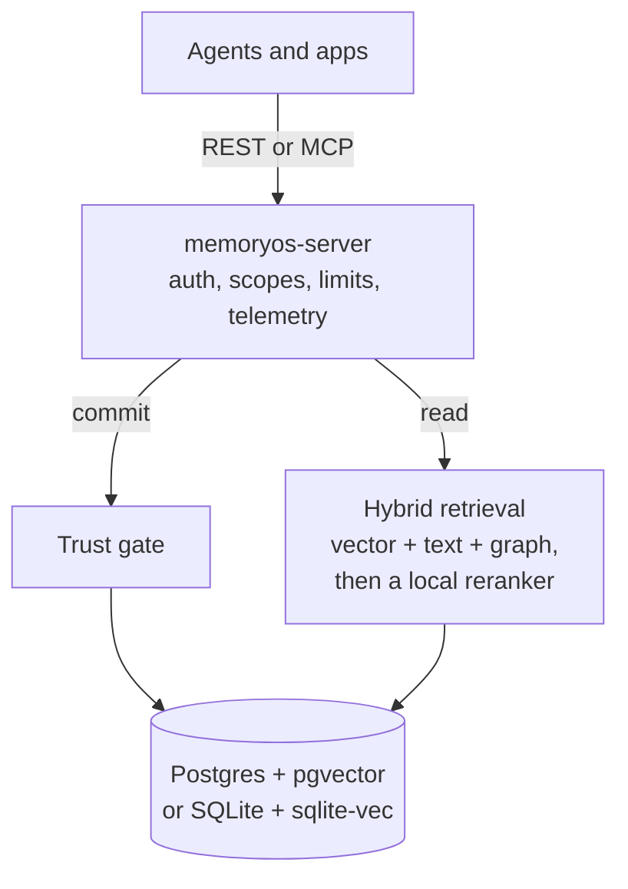
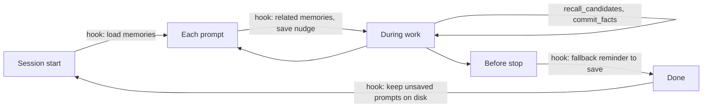

<div align="center">

# 🧠 MemoryOS

**Long-term memory for AI agents that stays current, traceable and hard to poison.**


[Why MemoryOS](#-why-memoryos) · [Quickstart](#-quickstart) · [How it works](#-how-it-works) · [Security](#-security) · [Agent hooks](#-agent-hooks) · [Roadmap](#-roadmap) · [Docs](#-documentation)

</div>

> [!NOTE]
> **Pre-release.** The server, REST API, MCP endpoint and Rust SDK run, and `memoryos setup` is tested
> end to end on macOS with Docker Desktop. It has not been run on Linux or Windows. No model has yet
> used these tools in a real agent session, so what an agent actually remembers is untested. The
> release targets below are goals, not results. Track the work in [`docs/PROGRESS.md`](docs/PROGRESS.md).

## ✨ Why MemoryOS

Most agent memory stops at "store text, search it later". Real memory also has to handle facts that
change and sources that lie.

| Capability | What you get |
|---|---|
| 👤 **Personal memory** | Facts scoped per user, reconciled so new information adds to, replaces or repeats what is known |
| 🕰️ **Memory over time** | A replaced fact is closed, not deleted, so you can ask what is true now or what was true then |
| ✍️ **Self-editing agents** | Size-limited, versioned blocks that agents edit through tools, with conflict detection |
| 🕸️ **Shared knowledge graph** | Every fact is also an edge between entities, shared across agents through scoped access |
| 🛡️ **Poisoning defense** | Low-trust content is quarantined, and every fact traces back to its source |
| 🔁 **One-call saving** | A repeated fact is matched on the server and counted as another source, and the response lists `related` facts, so the agent rarely needs a lookup before saving |
| 🔄 **Values that change** | Predicates such as `lives_in` or `has_nickname` hold one value at a time, so a new value replaces the old one without the agent asking ([`MEMORYOS_SINGLE_VALUED_PREDICATES`](docs/SPEC.md#10-configuration)) |
| ⏳ **Facts that expire** | A fact can carry `expires_at`, such as "on leave until Friday", and leaves recall after that date while staying in history |
| 🔐 **Secret redaction** | API keys, tokens and passwords in a commit are stored as `[redacted]`, and the response says when that happened |
| 🎯 **Reranked recall** | A local cross-encoder reorders the top results, in English and Chinese, with no API call |

## 🚀 Quickstart

One line on macOS (Apple silicon) or Linux (x86_64, arm64, glibc 2.38 or newer), with no Docker,
no Rust and no API key:

```bash
curl -fsSL https://raw.githubusercontent.com/feryadialoi/memoryos/main/install.sh | bash
```

It puts `memoryos` in `~/.local/bin` and runs `memoryos setup --local`: SQLite in
`~/.local/share/memoryos`, the server on `127.0.0.1:6366` with the `bge-reranker-base` reranker,
two keys, and Claude Code's hooks and MCP. The first start downloads about 760 MB of models. After
a reboot, the `memoryos mcp` that Claude Code launches starts the server again.
`MEMORYOS_AGENT=opencode` or `pi` connects another agent.

| | |
|---|---|
| Update to the latest release | `memoryos update` (migrates and restarts the server too) |
| Start, stop, restart the server | `memoryos start`, `memoryos stop`, `memoryos restart` |
| Remove it | `memoryos setup --uninstall --global`, add `--delete-data` to delete the database |

### With Docker and Postgres

Needs Docker running, and nothing else: no API key, no `.env`, no provider account. The agent's own
model decides what to remember, and embeddings run locally in the container.

```bash
cargo install --path crates/server
cd your-project
memoryos setup --agent claude-code   # or: opencode, pi
```

The first run builds the image, which takes several minutes, and downloads a 481 MB embedding model,
about 2.5 minutes on a fast connection and much longer on a slow one. The server is ready once that
model loads; a 571 MB reranking model then downloads in the background, and recall uses it from then
on. Later runs start in seconds and keep your data and keys.

The server container needs up to 2.5 GiB of memory with both models (`MEMORYOS_MEM_LIMIT`, default
`2560m`), so Docker needs room for that next to Postgres. `MEMORYOS_RERANKER=off` skips the reranker and fits in
`1536m`. Both settings are in [SPEC section 10](docs/SPEC.md#10-configuration).

`setup` starts Postgres and the server through Compose, creates two keys, and connects the agent over
`memoryos mcp`, a local stdio proxy. Agent configuration holds no key and no reference to one.

The checkout's Makefile has one set of commands for each way of running it on macOS. Run `make` to
list them.

| | Docker | Local (Homebrew Postgres on localhost:6432, no Docker) |
|---|---|---|
| Once per machine | `make docker-setup` | `make local-setup`, then `make local-import` to copy a Docker install's data and keys |
| Start, also after a reboot | Docker restarts it | `make local-start` |
| After pulling new code | `make docker-upgrade` | `make local-upgrade` |

To move a Docker install to local with its data, run this with Docker running:

```bash
make local-setup local-import local-start
```

It copies every fact, episode, entity, API key and audit event, prints how many facts it copied, and
starts the local server on the same address, so hooks, MCP and `credentials.json` keep working
unchanged. The Docker containers are stopped and their volumes kept as they were at the move;
nothing saved after it goes back to Docker.

The local server reads its settings from `~/.config/memoryos/server.env`. To choose the reranking
model there, compare them on this machine first, then switch:

```bash
memoryos reranker bench                    # right-fact-first score and speed of every model
memoryos reranker use bge-reranker-base    # saves to server.env and restarts the server
memoryos reranker status                   # settings, and the model the running server uses
```

`memoryos reranker top 5` reranks fewer facts per recall, and `memoryos reranker use off` turns it off.

| | |
|---|---|
| 📁 **Where things live** | `~/.config/memoryos`: `credentials.json` (mode 0600), the database and the generated password |
| 🔑 **Agent key** | Used by hooks and MCP. Scopes `agent:*`, `user:*`, `shared:*`, not an admin |
| 🛡️ **Admin key** | Used only by `memoryos quarantine` |
| 🎯 **Scope** | The current project by default, or `--global` for Claude Code and OpenCode |
| 🧹 **Removing it** | `memoryos setup --uninstall` keeps your data. Add `--delete-data` to erase it |

> [!WARNING]
> Both keys are in one file your user account can read. This stops an injected agent approving its own
> facts through MCP, but an agent with shell access can read that file or run `memoryos quarantine`.

Review what agents wrote outside their own scope:

```bash
memoryos quarantine list --scope user:alice
memoryos quarantine approve <fact-id>
```

Backups, upgrades and incidents are in the [runbook](docs/runbook.md).

### SQLite embedded backend

`memoryos setup` remains PostgreSQL-based. For a local SQLite database without a PostgreSQL server:

```bash
mkdir -p data
export MEMORYOS_STORE=sqlite
export DATABASE_URL="sqlite://$PWD/data/memoryos.db"
cargo run --package memoryos-server -- migrate
cargo run --package memoryos-server -- serve
```

Or use the isolated Compose stack, which persists the database in the `sqlite-data` volume:

```bash
docker compose -f deploy/docker-compose.sqlite.yml up -d --build
```

SQLite uses one writer connection, FTS5 and exact sqlite-vec cosine scans. It is intended for a
single server process, not a multi-instance or HNSW-scale deployment.

## 👀 See your memory

```bash
memoryos ui
```

This opens a page in your browser showing what is remembered. It needs no extra install, and it keeps
running until you press Ctrl+C. Press `/` to ask a question, `1` to `4` to switch views, and `Esc` to
close a detail panel.

| View | What it answers |
|---|---|
| **Facts** | What is known now, grouped by person or thing, and what was replaced |
| **Map** | How people and things connect. Click one to see only what touches it |
| **Timeline** | When each fact was true and how it changed |
| **Review** | What is held back from your agent, with its source, to approve or reject |
| **Ask** | The facts your agent would get for a question |


In a terminal, or over SSH with no browser, run `memoryos tui` instead. It has the Facts, Review, Ask,
Timeline and Map views. Keys: `1` to `5` switch views, `[` and `]` switch scope, `Enter` opens
a fact, `/` filters or asks, `a` and `r` approve or reject in Review, and `q` quits. On the Map, the
arrow keys hop between people and things, `+` and `-` zoom, `0` fits the whole map, `/` finds a name,
and `Enter` lists the selected one's facts. It makes only the
requests the page can make, so it can read and review but never delete or write facts.

### Is my agent using it?

```bash
memoryos stats            # last 14 days of Claude Code sessions; --days N, --json
```

It reads Claude Code's local transcripts and prints counts only, never their text: how often the
agent recalled and saved, how many sessions got memories from the hooks, and how much of the input was
read from the prompt cache.

The page is on your machine only. It never receives an API key: it calls a small local proxy that
forwards a fixed list of reads plus approve and reject, and it cannot purge, retract or write facts.
After upgrading from an older install, update the server with `make docker-upgrade` or `make local-upgrade`.

## 🔍 Example

This uses the Rust SDK. The user says *"I moved to Bandung"* after previously living in Jakarta, and the
agent's own model decides that this is a fact to save:

```rust
let mem = MemoryOs::connect(url, api_key).await?;
let user = Scope::user("u_123");

let fact = CommitFact::new("Ada moved to Bandung", EntityRef::new("Ada", "person"), "lives_in");
mem.commit(&Commit::new(user.clone(), "chat", "I moved to Bandung", vec![fact])).await?;

// Current answer: Bandung
let now = mem.recall(user.clone(), "where does the user live?").await?;

// Answer as of January 2025: Jakarta
let then = mem.recall(user, "where does the user live?")
    .as_of(date(2025, 1, 1))
    .await?;
```

## ⚙️ How it works



Everything reads from **one data model**, so text search, vector search and the graph cannot
disagree:

- **Episodes:** immutable raw input, the source of everything else.
- **Entities:** the people, places and things that facts connect.
- **Facts:** statements with two timelines, when they were true and when we learned them.
- **Blocks:** versioned working notes that an agent edits directly.

## 🛡️ Security

Research shows a poisoned memory survives across sessions, unlike ordinary prompt injection. So:

| Source | What happens to its facts |
|---|---|
| `external` content, such as web pages and documents | Quarantined until approved |
| `agent` writes to user or shared memory | Quarantined until approved |
| `agent` writes to its own scope | Active |
| Lower-trust statement contradicting higher-trust fact | Quarantined, and the original stays in place |
| `user` or `system` statements otherwise | Active |

- **Tenant isolation:** Postgres row-level security enforces it independently of query filters. The
  embedded SQLite backend uses explicit tenant predicates and tenant-aware foreign keys, covered by
  two-tenant integration tests; it does not claim RLS.
- **Purging:** removing one bad source deletes what was derived only from it and restores any fact
  it had replaced.
- **Audit trail:** approvals, rejections, retractions and purges are all recorded.

## 🪝 Agent hooks

The agent reads and saves memories through MCP tools. Hooks only load memories and remind the agent to
save, and they cannot bypass validation or quarantine. `memoryos setup` installs them for you.



| Hook | What it does |
|---|---|
| `memoryos hook session-start` | Recalls with the folder name and with a fixed query about the user (name, nickname, preferences, how they work), merges the two, and prints the agent's memory blocks for each `agent:<id>` hook scope. Output stays under 9,000 characters. |
| `memoryos hook prompt` | Recalls up to 5 facts with the prompt as the query, and prints only those this session has not shown yet. Prompts under 3 words skip recall. When the prompt looks like the user stating a fact ("my ", "I'm", "call me", "we decided", "remember", ...), it adds one line asking the agent to save it now. Prints nothing when there is nothing new. |
| `memoryos hook stop` | A fallback: once every 20 turns per session, asks the agent to save what it learned. |
| `memoryos hook session-end`, `memoryos hook pre-compact` | When the part of the session since the last capture has no `commit_facts` call, keeps the user's typed prompts in a local file for the next session start, which shows them once. Needs no server and prints nothing. |

Facts and blocks are printed inside a `<memoryos-memories>` block labelled as data, with stored text
escaped so it cannot close the block. The fact ids already shown are kept per session in
`~/.local/state/memoryos/hook-turns`, reset at each session start; files idle for 7 days are removed.

When a session ends, or is about to be compacted, without saving anything, its typed prompts would
be lost. No model is called and nothing leaves the machine. Instead, the capture hooks read the
transcript (`transcript_path` from the host), keep only what the user typed (not tool results, not
hook or system-reminder text, not `<memoryos-memories>` blocks), mask strings that look like secrets
(`sk-`, `ghp_`, `AKIA`, `mos_`, `xoxb-` keys, private key blocks, `password=...`, long hex or base64
runs) as `[redacted]`, and write the newest 4,000 characters to
`~/.local/state/memoryos/hook-turns/pending/<sha256 of session id>.txt` with mode 0600. The next
session start prints them, oldest first and under 4,000 characters, in a separate
`<memoryos-unsaved>` data block after the memories, followed by one line asking the agent to save any
durable fact with `commit_facts` and otherwise ignore them. The model of that session decides what is
worth saving. A file is deleted once shown, and after 14 days if it never is.

`MEMORYOS_HOOK_SCOPES` (default `agent:coding-agent`) names the scopes the hooks recall from, and
`MEMORYOS_HOOK_STOP_EVERY` (default 20) the stop interval. `memoryos mcp` also uses the hook scopes as
defaults: when the model omits `scopes` in `recall`, `recall_candidates` or `graph_neighbors`, or `scope`
in `commit_facts`, the proxy fills in every hook scope, or the first one for `commit_facts`. Its
`tools/list` marks those fields optional and names the defaults. A value the model sends is never
changed.

Without hooks, memory still works, but saving depends on the agent choosing to do it. A hook may
not run if the agent crashes or is killed, so agents should also save during work.

<details>
<summary><b>Claude Code setup</b></summary>

`.claude/settings.json`:

```json
{
  "hooks": {
    "SessionStart": [
      {
        "matcher": "startup|resume|clear|compact",
        "hooks": [{ "type": "command", "command": "memoryos hook session-start" }]
      }
    ],
    "UserPromptSubmit": [
      {
        "hooks": [{ "type": "command", "command": "memoryos hook prompt" }]
      }
    ],
    "Stop": [
      {
        "hooks": [{ "type": "command", "command": "memoryos hook stop" }]
      }
    ],
    "SessionEnd": [
      {
        "hooks": [{ "type": "command", "command": "memoryos hook session-end" }]
      }
    ],
    "PreCompact": [
      {
        "hooks": [{ "type": "command", "command": "memoryos hook pre-compact" }]
      }
    ]
  }
}
```

When a save is due, `memoryos hook stop` prints:

```json
{
  "decision": "block",
  "reason": "Before stopping, call commit_facts for durable facts learned in this session. If there are none, stop."
}
```

`Stop` fires at the end of every turn, so the command limits itself to once every 20 turns per
session. The prompt hook's nudge is the main save prompt; this is the fallback. `SessionEnd` cannot
ask the agent to save, because it has no decision control. It only keeps the unsaved prompts for the
next session.

</details>

<details>
<summary><b>Install as a Claude Code plugin</b></summary>

`integrations/claude-code` packages the same hooks, the `memoryos` MCP server and a short skill on
when to recall and what to save, as one Claude Code plugin. The repository root is its marketplace.
The `memoryos` binary must still be on `PATH`, and the server running (`memoryos setup` does both).

```text
/plugin marketplace add /path/to/memoryos
/plugin install memoryos@memoryos
```

The plugin replaces the settings edits that `memoryos setup --agent claude-code` makes. Use one or
the other: with both, every hook runs twice. To switch to the plugin, run
`memoryos hook uninstall --agent claude-code` (add `--global` if you installed globally) first. As a
plugin, the MCP tools are named `mcp__plugin_memoryos_memoryos__*` instead of `mcp__memoryos__*`.

</details>

<details>
<summary><b>OpenCode setup</b></summary>

`.opencode/plugins/memoryos.ts` and an `mcp.memoryos` entry in `opencode.json`. The plugin adds recalled
memories to compaction. It does not remind the agent to save, which would need a separate handler.

</details>

<details>
<summary><b>Pi setup</b></summary>

`.pi/mcp.json` in the project, plus a short block in `AGENTS.md` that says when to recall and save. Pi
has no hooks here. Pi reads the project file only in a trusted project, so run `/trust` in Pi once.
Project scope only: `setup` does not touch `~/.pi/agent/mcp.json`.

</details>

<details>
<summary><b>Agent configuration only</b></summary>

For a server you already run. Set `MEMORYOS_URL` and `MEMORYOS_API_KEY`, which override the stored
credentials for every command:

```bash
memoryos hook install --agent claude-code   # or: opencode, pi
memoryos hook uninstall --agent claude-code
```

</details>

The `memoryos hook` commands never fail the host: on an error they log to stderr and exit 0.

| Agent | Checked against the real program, with no model turn |
|---|---|
| OpenCode 2.2.5 | The plugin loads, and MCP connects through `memoryos mcp` with 6 tools |
| Pi 1.4.0 | `pi mcp list` connects through `memoryos mcp` with 6 tools, in a trusted project |
| Claude Code | Not run. Only the written files and the proxy are tested |

Untested in all three: a model actually calling the tools, the OpenCode compaction hook firing, and
Pi following its `AGENTS.md` block.

References:
[Claude Code hooks](https://code.claude.com/docs/en/hooks),
[OpenCode plugins](https://opencode.ai/v2/docs/build/plugins/).

## 🗺️ Roadmap

- [x] **Wave 0:** specification, core contracts, database schema, API contract
- [x] **Wave 1:** Postgres store, embedding client, eval harness
- [x] **Wave 2:** ingest, hybrid retrieval
- [ ] **Wave 3:** server, MCP, SDK, deployment
- [ ] **Wave 4:** integration, load test, restore drill, independent review

### Release targets

These are goals, not measured results:

| Gate | Target |
|---|---|
| ⚡ Recall latency | p95 under 200 ms at 1M facts, excluding embedding |
| 🕰️ Staleness | At least 95% of replaced facts absent from current recall |
| 🛡️ Poisoning | 0 poisoned facts in recall without approval |
| 🔒 Isolation | 0 cross-tenant reads |

## 📚 Documentation

| Document | Contents |
|---|---|
| [`docs/runbook.md`](docs/runbook.md) | Install, upgrades, backup and restore, keys, monitoring, incidents |
| [`docs/vps-deployment.md`](docs/vps-deployment.md) | Running it privately on a VPS, deployed on every merge |
| [`docs/SPEC.md`](docs/SPEC.md) | Behavior and contracts |
| [`docs/comparison.md`](docs/comparison.md) | How MemoryOS differs from Mem0 and Graphiti |
| [`docs/PLAN.md`](docs/PLAN.md) | Development waves and ownership |
| [`docs/PROGRESS.md`](docs/PROGRESS.md) | Status, with proof for each task |
| [`docs/openapi.yaml`](docs/openapi.yaml) | REST API contract |
| [`docs/adr/`](docs/adr/) | Architecture decisions |

## 🧪 Development

Requires Rust 1.94+ and Docker for PostgreSQL integration tests. SQLite integration tests use local
temporary files and need no Docker. Do not use `cargo test --all-features`, which downloads the
embedding model. The test feature list is in [`.github/workflows/ci.yml`](.github/workflows/ci.yml).

```bash
cargo fmt --all --check
cargo clippy --workspace --all-targets --all-features -- -D warnings
cargo test --workspace --features memoryos-store/integration,memoryos-store/integration-sqlite,memoryos-ingest/integration,memoryos-ingest/integration-sqlite,memoryos-retrieve/integration,memoryos-retrieve/integration-sqlite,memoryos-eval/integration,memoryos-server/integration,memoryos-server/integration-sqlite,memoryos-hooks/integration
cargo deny check
```

## 📄 License

Apache-2.0, as declared in `Cargo.toml`.
